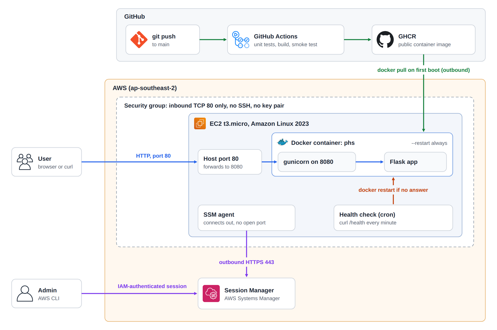

# platform-health-service

A small Flask app running in Docker on an AWS EC2 instance. `/` returns a hello message and `/health` returns `{"status":"ok"}`.

Terraform creates the AWS resources, GitHub Actions tests the app and publishes the image to GHCR, and a cron job on the instance restarts the container if `/health` stops answering.

## Architecture



A request comes in on port 80, which is the only port the security group allows. Docker forwards it to port 8080 in the container, where gunicorn passes it to Flask.

There's no SSH access and no key pair. I connect to the instance through SSM Session Manager, which logs in with IAM and doesn't need an open port because the agent connects out over 443.

The container starts by itself after a reboot, because Docker is enabled at boot and the container runs with `--restart always`.

## What's in the repo

```
app/app.py                     the Flask app
tests/test_app.py              unit tests
Dockerfile                     builds the image, runs as a non-root user
.github/workflows/ci-cd.yml    tests, builds, smoke tests and publishes the image
terraform/                     security group, IAM role and EC2 instance
terraform/user_data.sh         first boot setup: Docker, the container and the health check
```

## Prerequisites

- Docker and Python 3.12 to run it locally
- Terraform 1.6 or newer
- AWS CLI v2 with the [Session Manager plugin](https://docs.aws.amazon.com/systems-manager/latest/userguide/session-manager-working-with-install-plugin.html)
- An AWS account with a default VPC, and permission to create EC2, security group and IAM resources

## Run it locally

```bash
python3 -m venv .venv
source .venv/bin/activate
pip install -r requirements.txt
python -m unittest discover tests -v

docker build -t platform-health-service .
docker run -d -p 8080:8080 --name phs platform-health-service
curl localhost:8080/health
docker rm -f phs
```

## Deploy to AWS

```bash
cd terraform
export AWS_PROFILE=<your-profile>
export AWS_REGION=ap-southeast-2
terraform init
terraform apply
```

The instance takes a minute or two to boot and pull the image from GHCR. The image is public, so it doesn't need a login.

I used `ap-southeast-2` because it's the only region my account allows. To use another one, set `AWS_REGION` to it and run `terraform apply -var="region=$AWS_REGION"`.

## Updating the app

Pushing to `main` publishes a new image, but the instance only pulls one on first boot, and `terraform apply` won't notice because the image name stays the same. For now the update is manual. In an SSM session:

```bash
sudo docker pull ghcr.io/rakesh-krishnamoorthy/platform-health-service:latest
sudo docker rm -f phs
sudo docker run -d --name phs --restart always -p 80:8080 ghcr.io/rakesh-krishnamoorthy/platform-health-service:latest
```

Or replace the instance, which pulls the newest image but changes the public IP:

```bash
terraform apply -replace=aws_instance.app
```

## Check that it works

`terraform apply` prints the public IP and instance ID. You can see them again with `terraform output`.

```bash
curl http://<public-ip>/health          # {"status":"ok"}
curl http://<public-ip>/                # hello message
nc -zv -w 5 <public-ip> 22              # times out, SSH is closed
```

Connect to the instance:

```bash
aws ssm start-session --target <instance-id>
```

To test the health check, freeze the app and give cron time to notice:

```bash
sudo docker pause phs
sleep 90
sudo journalctl -t healthcheck     # health check failed - restarting container phs
sudo docker ps                     # phs is running again
```

To test a restart, reboot the instance, wait a minute or two, then call `/health` again:

```bash
aws ec2 reboot-instances --instance-ids <instance-id>
```

## CI

The workflow runs on pushes to `main` and on pull requests. It runs the unit tests, builds the image, starts it and checks `/health`. On `main` it then pushes the image to GHCR, tagged `latest` and with the short commit SHA. There are no AWS credentials in GitHub.

Output from [an earlier run](https://github.com/rakesh-krishnamoorthy/platform-health-service/actions/runs/41904835171):

```
test_health (test_app.AppTests.test_health) ... ok
test_home (test_app.AppTests.test_home) ... ok
test_unknown_path_returns_404 (test_app.AppTests.test_unknown_path_returns_404) ... ok
Ran 3 tests in 0.075s
OK

Smoke test the container
{"status":"ok"}
```

## Cleanup

```bash
cd terraform
terraform destroy
```

This removes everything Terraform created.

## Troubleshooting

| Problem | What to check |
|---|---|
| `curl` times out right after deploying | The instance is probably still booting. Give it two minutes, then check `/var/log/cloud-init-output.log` |
| `curl` keeps timing out | Check the instance is running and port 80 is still allowed. `terraform plan` shows any manual changes |
| Connection refused | The container isn't running. Try `sudo docker ps -a` and `sudo docker logs phs` |
| `docker ps` is empty after boot | The image may still be downloading. If it stays empty, look for a failed pull in `/var/log/cloud-init-output.log`, then replace the instance |
| `TargetNotConnected` from SSM | The agent may not have registered yet, or `AWS_REGION` is wrong. Wait a couple of minutes and check the region |
| `journalctl -t healthcheck` is empty | That's normal. It only logs failures |

## If the service goes down

This is the order I'd check things in:

1. Run `curl -v http://<ip>/health` from outside. A timeout points to the network or instance, connection refused to the container, and a 5xx to the app.
2. Check the instance is running and passing its status checks in the EC2 console.
3. Check the security group still allows port 80. `terraform plan` will show if it was changed.
4. Connect with SSM and run `sudo docker ps -a`. If the container keeps restarting, `sudo docker logs phs` usually shows why.
5. Run `curl localhost/health` on the instance. If that works but the outside check doesn't, the problem isn't the app.
6. Run `sudo journalctl -t healthcheck` to see if the health check has been restarting it.
7. Check disk and memory with `df -h` and `free -m`. A full disk breaks Docker, and a t3.micro only has 1 GB of memory.

To recover quickly, try `sudo docker restart phs`, then a reboot, and if that fails, `terraform apply -replace=aws_instance.app`.

## Limitations

- New images are updated by hand because GitHub OIDC isn't set up, so CI has no access to AWS. The next step would be a deploy job using OIDC and `aws ssm send-command`.
- The instance uses the `latest` tag to keep things simple. CI also tags each image with its commit SHA, so `var.image` can be pinned to an exact version.
- It's a single instance over plain HTTP. For production I'd put an Auto Scaling group behind a load balancer with a TLS certificate.
- The health check runs on the instance and only writes to the system journal. It can't report the whole instance going down, and it won't alert anyone. CloudWatch alarms or an external check would cover that.
- CI doesn't check the Terraform code. I ran `terraform fmt` and `terraform validate` by hand.
- Terraform state is local, which is fine for one person.
- `t3.micro` is free-tier eligible on my account, but AWS bills public IPv4 addresses separately, so run `terraform destroy` when you're done.
